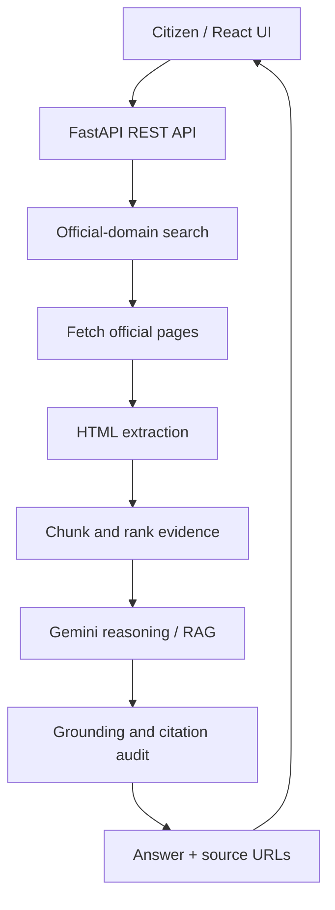

# CivicSaathi AI — Multilingual Policy, Rights & Scheme Explainer

A full-stack civic information assistant for the **Civic Pulse, Digital Governance & Public Information** hackathon track.

CivicSaathi AI retrieves current material from official Indian government websites, extracts relevant passages, and uses Gemini to explain policies, citizen rights, and welfare schemes in accessible language with source links.

> **Important:** This repository contains working application code, not a deployed service. Live retrieval requires internet access; AI answers require a Gemini API key. Search results and government websites can change. Always verify critical deadlines and legal decisions with the linked authority.

## Features

- Official-domain web search (government and public institution domains only).
- Direct ingestion of an official HTTPS page URL.
- Retrieval-augmented generation (RAG): fetch → extract → chunk → rank → answer.
- Gemini-powered explanations in English, Hindi, Bengali, Tamil, Telugu, Marathi, Kannada, Malayalam, Gujarati, Punjabi or Urdu.
- AI-assisted translation of the interface and all 36 Indian States/Union Territories when a Gemini API key is configured. Hindi and Telugu state names also have local fallbacks.
- State/UT filters, select-all/clear controls, and up to 20 official search results per query.
- Structured answer sections: summary, eligibility, benefits/rights, documents, application steps and caveats.
- Source-linked answers; model is instructed to cite numbered sources and avoid unsupported claims.
- Basic second-pass citation/grounding audit.
- Multilingual text-to-speech: the reader follows the selected language, translates highlighted/page/source text when needed, and uses a matching installed browser/device voice when available. Includes pause, resume and stop controls.
- Friendly no-results recovery: when live search returns no exact match or is unavailable, the interface offers official government portals instead of leaving the user at a dead end. Search tries an English translation for non-English queries when the AI key is configured.
- Clickable source titles open the official source directly in a new tab.
- No bundled fake scheme records, mock statistics or hardcoded demo answers.

## Architecture



### Stack
- Frontend: React, Vite, plain CSS.
- Backend: Python, FastAPI, Pydantic, Requests, BeautifulSoup, Trafilatura.
- AI: Google Gemini API (`gemini-2.5-flash`, configurable).
- Retrieval: live official-site search and lightweight in-request evidence ranking.
- Speech: Web Speech API (browser-native).

## Run locally

### 1. Requirements
- Python 3.12 (recommended; Python 3.14 may fail to install pinned pydantic-core)
- Node.js 18+
- A Google AI Studio Gemini API key for AI responses.

### 2. Backend

```bash
cd backend
python -m venv .venv
# Windows:
.venv\Scripts\activate
# macOS/Linux:
source .venv/bin/activate
pip install -r requirements.txt
cp .env.example .env
```

Add your key to `backend/.env`:

```env
GEMINI_API_KEY=your_key_here
GEMINI_MODEL=gemini-2.5-flash
FRONTEND_ORIGIN=http://localhost:5173
```

Start the API:

```bash
uvicorn app:app --reload --port 8000
```

API docs: http://localhost:8000/docs

### 3. Frontend

In a second terminal:

```bash
cd frontend
npm install
npm run dev
```

Open http://localhost:5173

## Example workflow

1. Choose a language.
2. Search a question such as "PM-KISAN eligibility and how to apply" or paste a government notification URL.
3. Select relevant official sources.
4. Ask the question. The backend fetches current pages, ranks evidence and requests a cited answer from Gemini.
5. Open the source links and verify the relevant clause before acting.

Search displays up to 20 matching official results returned by the live search provider; no search engine can guarantee every page on the internet. If no exact result is found or live search is unavailable, the interface offers links to official government portals so users can continue exploring. The app does not fabricate scheme details or pretend a fallback portal is an exact match.

## API

- `GET /api/health` — service status and AI-key configuration status.
- `POST /api/search` — search official sources for a query.
- `POST /api/ingest-url` — fetch one official HTTPS URL.
- `POST /api/ask` — answer using supplied source URLs and fetched evidence (up to 20 selected sources, fetched with bounded concurrency).
- `POST /api/translate-ui` — translate interface strings while preserving UI keys and structure.
- `POST /api/translate-text` — translate text into the selected language for voice reading.

## Data integrity and safety

- The search layer restricts results to a list of official Indian government/public-institution domains.
- URL ingestion accepts HTTPS URLs on approved government domains only and rejects private/local IP destinations.
- The model is instructed to say when evidence is insufficient, distinguish eligibility rules from recommendations, and cite claims.
- The grounding audit checks whether answer claims appear supported by retrieved passages; it is a heuristic, not a legal certification.
- This is an informational prototype, not legal advice or an official government service. Do not enter Aadhaar numbers, bank details, passwords or other sensitive personal data.
- Before hackathon submission, test with live official pages, document any source failures, add your team's details, and deploy the app.

## Deployment

- Backend: Render / Railway / any Python ASGI host. Set `GEMINI_API_KEY`, `GEMINI_MODEL`, and `FRONTEND_ORIGIN`.
- Frontend: Vercel / Netlify. Set `VITE_API_BASE` to the deployed backend URL.
- Configure HTTPS and the exact production frontend origin. Never commit `.env` or API keys.

## Suggested judging demo

Use a current official scheme page or notification:
1. Search for the scheme.
2. Show official source URLs and dates where present.
3. Ask for eligibility and documents in Hindi or Bengali.
4. Show answer citations and open a source.
5. Ask a follow-up about a specific eligibility condition.
6. Demonstrate the insufficient-evidence response by asking for a detail not present in the retrieved pages.

## Repository checklist

- [ ] Add team name and member details to the pitch deck.
- [ ] Test search and ingestion against official URLs before demo.
- [ ] Set secrets in deployment environment variables.
- [ ] Record a live end-to-end demo (do not fake or pre-record interactions).
- [ ] Add screenshots and a deployment URL after deployment.
